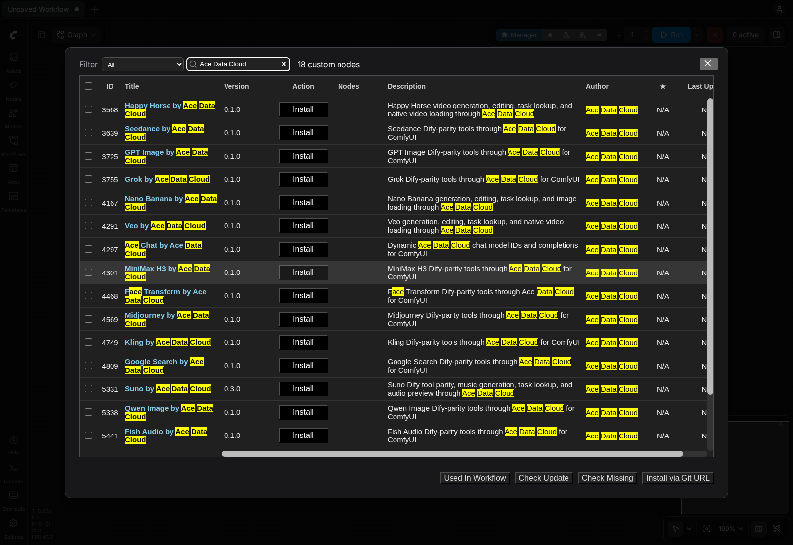
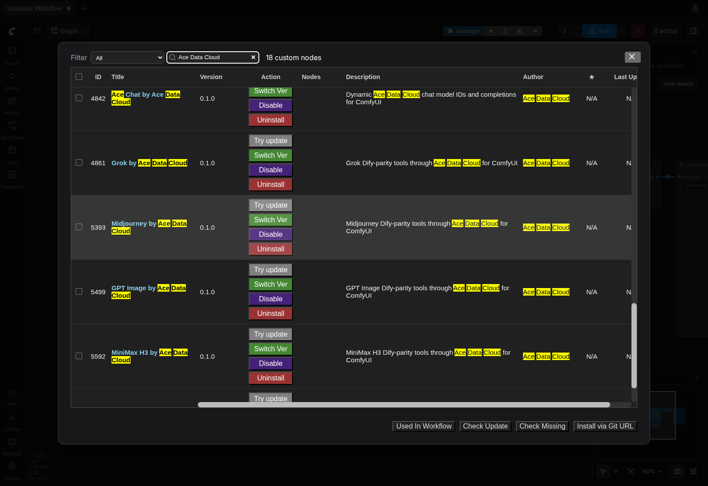
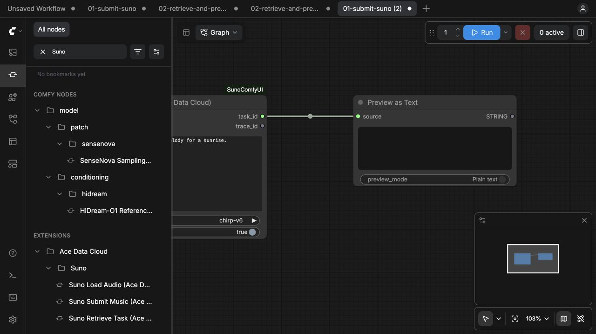
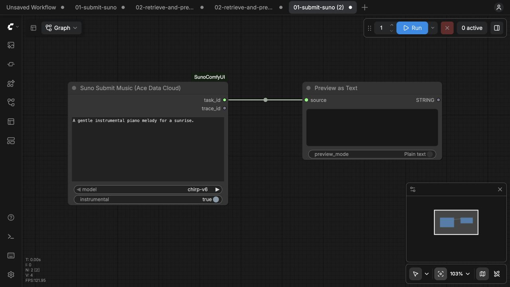
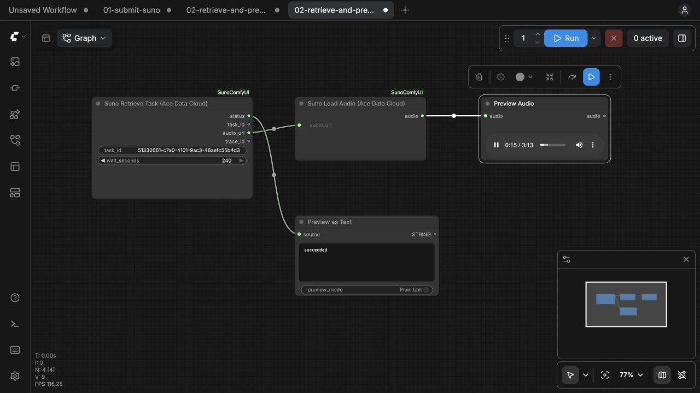

# Ace Data Cloud 的 ComfyUI Suno 节点

通过 Ace Data Cloud 账户生成 Suno 音乐，按**同一个任务 ID**查询结果，并在 ComfyUI 预览或保存音频。节点调用云 API，无需本地模型或显卡。API 消耗以[当前 Suno 价格](https://platform.acedata.cloud/models?utm_source=comfyui&utm_medium=referral&utm_campaign=evergreen&utm_content=sunocomfyui_readme_zh_cn_pricing)和账户 Credits 为准，与 ComfyUI Credits 分开。

[English guide](../README.md)

五个引导节点包括 **Suno Submit Music**（收费生成一次并显示任务 ID）、**Suno Retrieve Task**（只查询已有任务）、**Suno Load Audio**（解码成 ComfyUI `AUDIO`），以及歌词提交和歌词任务查询。音乐节点覆盖当前 Dify Suno 插件的 10 个音乐 model ID，歌词节点覆盖 `default`、`remi-v1`。另有 19 个合同驱动节点逐项覆盖 Dify 正式工具定义与 action。引导工作流使用返回的第一首音频；高级节点的 `media_urls_json` 保留全部链接。


## 当前版本与安装来源

本源码版本为 **0.3.2**，版本 ZIP 见 [GitHub Releases](https://github.com/AceDataCloud/SunoComfyUI/releases)。下文 Registry 安装段保留 **2026-10-19 已核 Active 的 0.3.0**；该旧 ZIP 尚不包含本版更新的图文、示例或修复。需要本版时，使用对应 GitHub Release ZIP，或等 Registry 中准确的 **0.3.2** 变为 Active 后再手选该版本；不要用默认 nightly 代替已核 stable。

从 GitHub ZIP 安装：停止 ComfyUI，先备份已有同名节点目录，把 ZIP 内文件解压到 `ComfyUI/custom_nodes/ace-suno/`（不要多嵌套一层目录），在该目录运行 `python -m pip install -r requirements.txt`，然后重启并刷新。API Token 仍只配在实际启动进程环境中。GitHub ZIP 安装与 Registry/Manager 正式稳定版安装是不同路径。

## 1. 安装

打开官方 [Suno by Ace Data Cloud Registry 页面](https://registry.comfy.org/nodes/ace-suno)，或在 **Manager → Custom Nodes Manager** 搜索 **Suno**；找不到时再搜 **Ace Data Cloud**。选择 **Suno by Ace Data Cloud**，核对发布者 **acedatacloud** 和源码仓库 [`AceDataCloud/SunoComfyUI`](https://github.com/AceDataCloud/SunoComfyUI)，再点击 **Install**。在 **Select Version** 版本对话框明确选择已批准的 Registry 稳定版 **0.3.0**；普通对话框可能默认高亮 **nightly**，本教程不要直接接受该选项。保留依赖自动安装。出现 **Restart Required** 后重启 ComfyUI，并刷新浏览器。Registry ID 为 `ace-suno`。





以上原图来自 **2026-10-16、Linux ComfyUI 0.41.0** 的发布者品牌搜索安装验收，不是本轮新生成，也不是服务词搜索实拍；见[图片来源与边界](screenshot-sources.json)。

这条 Registry 稳定版安装路径已于 **2026-10-16 在原版 Linux CPU ComfyUI 0.41.0** 验证；该次安装验收没有提交生成或聊天请求。更新的宿主版本及每个收费动作仍需分别验证，模型可用性与价格以当前服务规则为准。

## 官方Manager可选legacy条目

[ComfyUI-Manager #3365](https://github.com/Comfy-Org/ComfyUI-Manager/pull/3365)已于 **2026-10-19** 合并。含[该官方条目](https://github.com/Comfy-Org/ComfyUI-Manager/blob/a74929c65b49d7d7d81b9a6f140de878a818b893/custom-node-list.json#L62318)的Manager版本可在文档所述Local DB列出 **Suno by Ace Data Cloud**。核对精确仓库，验证过的稳定路线仍手选Registry **0.3.0**。条目里的`git-clone`/`SunoComfyUI`来源句柄与显式稳定版`ace-suno@0.3.0`不同，nightly/Git不等于该Registry包。

**2026-10-20 Asia/Shanghai** 已在原版Linux ComfyUI **0.41.0**、未修改官方Manager `a74929c6`验证Local DB命令行发现、明确安装`ace-suno@0.3.0`且保留依赖、启用回读和24节点宿主加载，无Key或上游调用。这是CLI/宿主证据，不是新UI实拍、付费成品、GitHub `0.3.2`的普通安装、默认Partner或精选。现有Registry路线独立于本可选legacy条目。

源码`pyproject.toml`当前版本 **0.3.2**；已发布Active Registry仍是 **0.3.0**（2026-10-20读回）。源码声明不代表Registry新版已激活，不覆盖上传旧版本。

## 注册并获取 API Token

### 复制或创建自己的 API Token

Ace 应用页与其他集成共用：图中 **1** 复制已有 Token，**2** 打开**管理 Key**，再选**创建**。新账户先注册/登录并初始化**通用应用**；确认本服务权限、当前价格、余额、有效期和允许的 API 限制。


以上是 **2026-10-08** 的真实脱敏 Ace 控制台原图，复用自 SunoDify；第二图示例名为 `Dify tutorial`，此处请命名为 `ComfyUI`。本次未创建凭据。Token 只配在**启动 ComfyUI 的进程环境变量** `ACEDATACLOUD_API_KEY` 中并重启；节点没有图示的 Key 输入框，不要贴进提示词、JSON 参数或工作流文件。其他终端的 export 不会配置已经运行的 Desktop 进程。

1. 登录 [Ace Data Cloud → 应用](https://platform.acedata.cloud/console/applications?utm_source=comfyui&utm_medium=referral&utm_campaign=evergreen&utm_content=sunocomfyui_readme_zh_cn_api_key)。新账户没有通用应用时，先选择**初始化通用应用**。
2. 打开**通用应用**，确认已开通本节点使用的服务。单服务应用的 Key 只限该服务。可复制已有 API Key；需要独立 Key 时，选择**管理 Key → 创建**，命名为 `ComfyUI`。
3. 只复制 Token 字符串，不加 `Bearer ` 或引号。平台管理 Token 不能代替节点调用 API 的 Key。若启用**允许的 API**限制，需同时包含工作流用到的提交和任务查询路径；收费动作前核对当前价格与 Credits 余额。

如需本地源码测试，可运行：

```bash
cd /path/to/ComfyUI/custom_nodes
git clone https://github.com/AceDataCloud/SunoComfyUI.git
cd SunoComfyUI
python -m pip install -r requirements.txt
```

重启后在节点搜索中输入 **Suno**，确认五个引导节点和 19 个 Dify 工具节点都能加载。源码可下载并不代表 Registry 或 Manager 已可发现，需要分别核验。



## 2. 配置有 Suno 权限的 Key

1. 登录 [Ace Data Cloud 控制台](https://platform.acedata.cloud/console/applications?utm_source=comfyui&utm_medium=referral&utm_campaign=evergreen&utm_content=sunocomfyui_readme_zh_cn_api_key)，打开已开通 Suno 的应用。使用已有 Key，或创建专用 Key。设置 API 路径限制时允许 `/suno/audios`、`/suno/lyrics` 和 `/suno/tasks`。
2. 生成前查看当前价格及 Credits 余额。短提示词不一定降低单次生成费用。
3. 在 **ComfyUI 进程环境**中配置 Key，然后重启。终端安装示例：

```bash
export ACEDATACLOUD_API_KEY='在此填写私有 Key'
python main.py --cpu
```

Key 只放在私有 shell 或进程管理器中，不写入工作流 JSON、仓库、截图或 Issue。已有环境也支持 `ACEDATACLOUD_API_TOKEN`。ComfyUI Desktop 需要在启动 Desktop 进程前配置环境；其他终端的 `export` 不会自动传过去。

## 3. 提交一次生成

下载 [01-submit-suno.json](../examples/01-submit-suno.json)，拖入 ComfyUI 画布或通过 **File → Open** 打开。示例把 **Suno Submit Music** 接到内置 **Preview as Text**，以便在画布看到任务 ID。提示词为 `A gentle instrumental piano melody for a sunrise.`，模型为 `chirp-v6`，**Instrumental** 开启。更换模型前先查价格和可用性。

只点击一次 **Run**，从 **Preview as Text** 复制 **Suno task ID**。异步请求被接受不代表歌曲已完成。若提交超时或没有任务 ID，先查 Ace 请求记录；插件不会自动重试收费生成。

音乐模型：`chirp-v6`、`chirp-v6-wild`、`chirp-v6-mini`、`chirp-v5-5`、`chirp-v5`、`chirp-v4-5-plus`、`chirp-v4-5`、`chirp-v4`、`chirp-v3-5`、`chirp-v3-0`。旧模型使用前请核对当前可用性和价格。



## 4. 查询同一任务并预览

下载 [02-retrieve-and-preview.json](../examples/02-retrieve-and-preview.json) 并导入。把 `PASTE_YOUR_TASK_ID_HERE` 改为上一步的任务 ID。工作流为 **Suno Retrieve Task → Suno Load Audio → Preview Audio**，状态输出另接内置 **Preview as Text**。

点击 **Run**。查询节点最多等待 240 秒，每五秒查询**同一个 ID**。任务成功后，下载节点把媒体链接解码为 ComfyUI `AUDIO`，可在 Preview Audio 播放。需要本地文件时换接 **Save Audio**。

超过 240 秒仍是 pending 时，Load Audio 会提示任务未完成。只重新运行这个**查询工作流**，继续用同一个 ID；不要重新运行提交工作流。ComfyUI 队列完成也不能代替服务终态和可播放音频。



## 5. 生成歌词

导入 [03-submit-lyrics.json](../examples/03-submit-lyrics.json)，选择 `default` 或 `remi-v1`，只提交一次。节点可能直接返回歌词 JSON，也可能返回任务 ID。若得到任务 ID，导入 [04-retrieve-lyrics.json](../examples/04-retrieve-lyrics.json)，填入同一个 ID，只查询到 `succeeded`。提交超时后先查请求记录，不自动重试收费操作。

## 6. 使用其余 Dify 工具

在节点搜索中输入 **Suno**，可找到扩展、翻唱、分轨、风格优化、格式转换、Persona、Voice、自定义模型、项目和批量查询等 19 个工具节点。固定 model/action 可直接选择；其他参数有具名输入框，也可放进 `parameters_json` JSON 对象。具名非空字段覆盖 JSON。原 Dify 发布合同会在请求前校验。删除/归档需在 JSON 设置 `confirm: true` 或打开确认控件；收费请求不自动重试。输出的 `task_id` 用于同 ID 查询，`media_urls_json` 保留全部媒体链接。

## 7. 账单与排障

在 [Ace Data Cloud 控制台](https://platform.acedata.cloud/console/applications?utm_source=comfyui&utm_medium=referral&utm_campaign=evergreen&utm_content=sunocomfyui_readme_zh_cn_api_key)按任务或 Trace ID 检查请求记录及 Credits 扣费。任务查询不应产生新的音乐生成。

| 现象 | 处理 |
| --- | --- |
| 找不到 Key | 在实际 ComfyUI 进程配置 `ACEDATACLOUD_API_KEY`，然后重启。 |
| HTTP 401/403 | 检查 Key、Suno 开通、路径权限和内容限制。 |
| HTTP 429 | 等待限额恢复；若已有任务 ID，继续查同一个任务。 |
| pending | 使用同一个任务 ID 重跑查询工作流。 |
| 提交 HTTP 5xx/超时 | 先查 Ace 请求记录，确认是否已经受理。 |
| 音频下载失败 | 确认任务成功且媒体链接有效；重新查任务，不要重新生成。 |

插件把提示词发往 `api.acedata.cloud`，从 Ace CDN 下载完成的音频。Key 只从本机进程环境读取，不保存在工作流中。只提交有权处理的内容。详见[隐私说明](PRIVACY.md)。

查询节点每次队列执行都会重新读取同一任务，不复用旧pending结果；收费提交在输入不变时仍保留缓存，避免查询时重发收费生成。导入或运行工作流前先关闭自动队列/自动运行，提交图只明确运行一次。
